# Cashflow

A simple, calm expense tracker for iOS and Android. Arabic-first (RTL), with French and English.

- Google Sign-In only
- Add / edit / delete expenses (amount, category, optional note, date), swipe-to-delete with undo
- Filter by category
- Total card on Home switchable between **today / this week / this month**, compared with yesterday / last week / last month (tap the chip on the card; the choice is remembered, weeks start on Monday)
- Manage categories (name, color, icon, drag to reorder; deleting moves expenses to "Other")
- Settings: language (العربية / Français / English, live switch), currency, dark/light theme, log out
- **Home-screen "Today" widget** (Android + iOS): what you spent today; tap → Add sheet

**Stack:** Flutter · Riverpod 3 · go_router · Supabase (Postgres + Auth) · google_sign_in 7 · home_widget · intl/ARB · shared_preferences.

## Screenshots

| Login | Home | Add expense | Edit / delete |
|:---:|:---:|:---:|:---:|
| 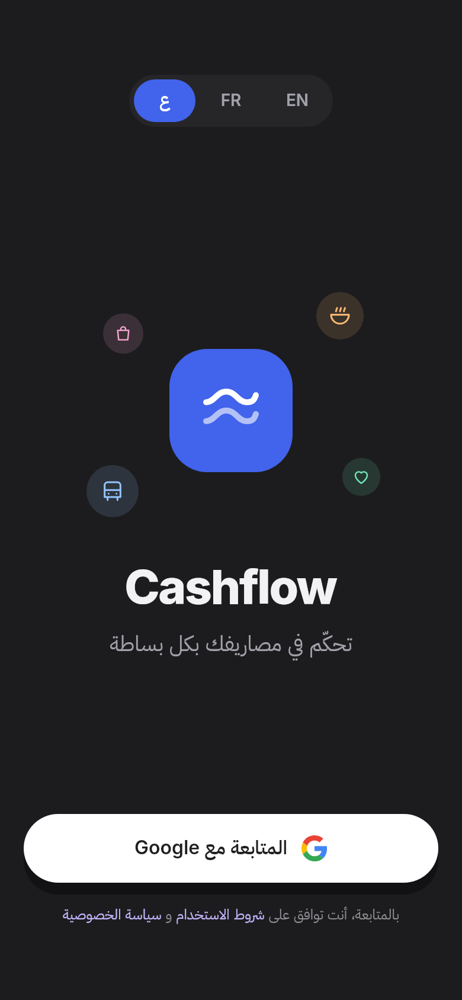 | 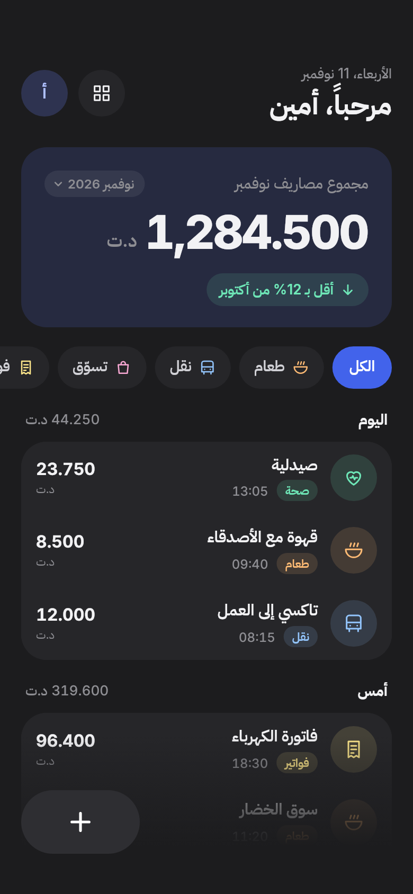 | 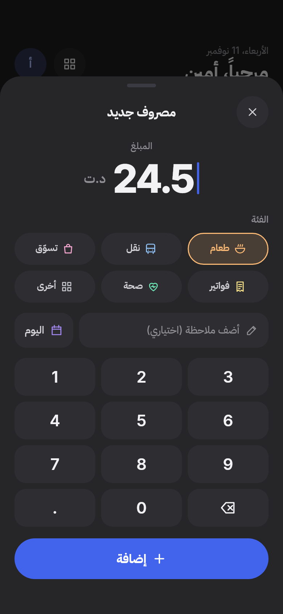 | 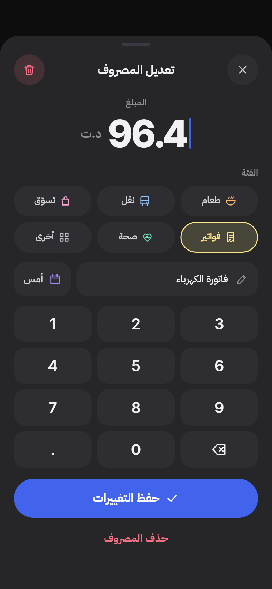 |
| **Empty state** | **Categories** | **New category** | **Settings** |
| 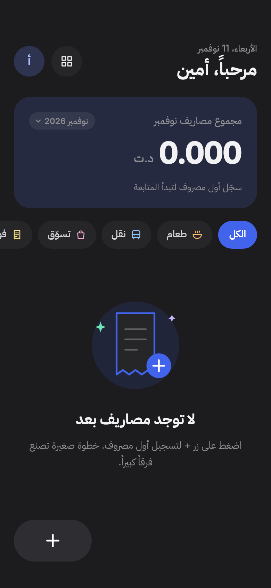 | 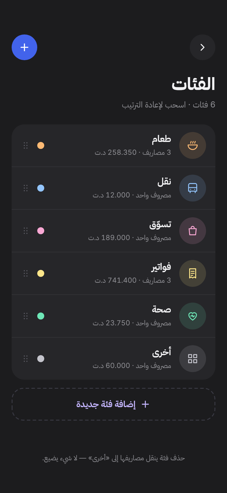 | 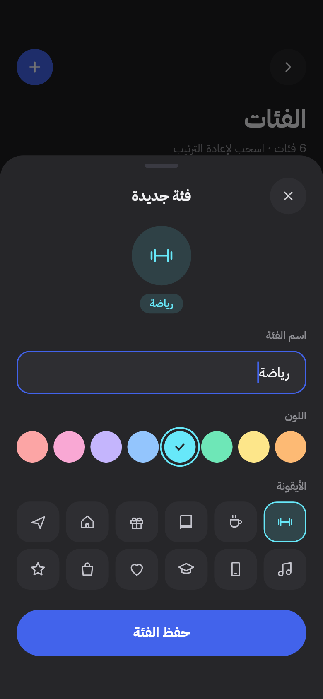 | 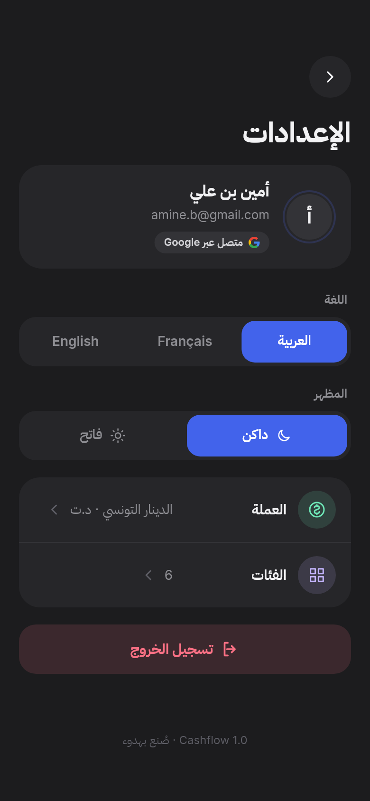 |
| **English (LTR)** | **Français (LTR)** | **Light mode** | **Total: pick a period** |
| 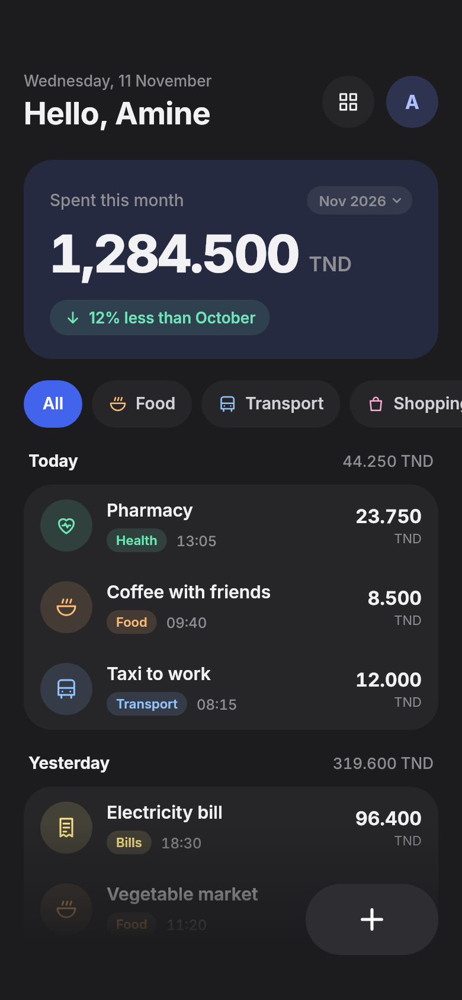 | 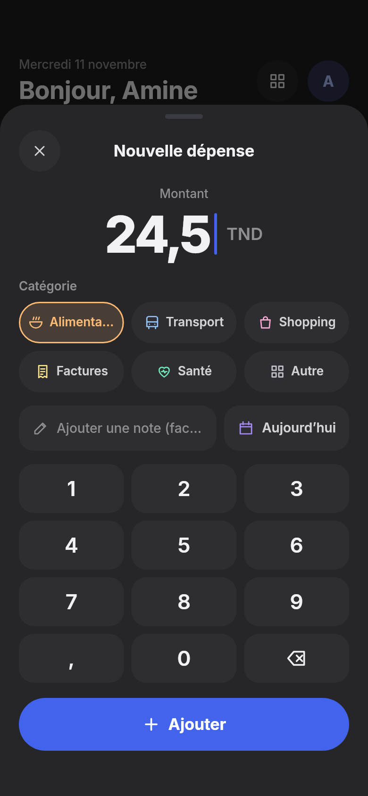 | 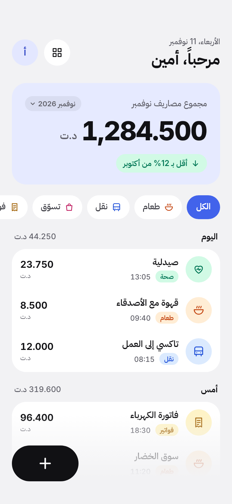 | 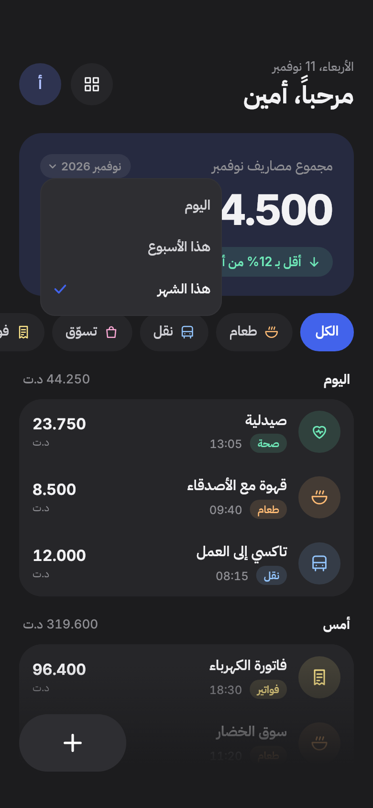 |
| **Total: this week** | | | |
| 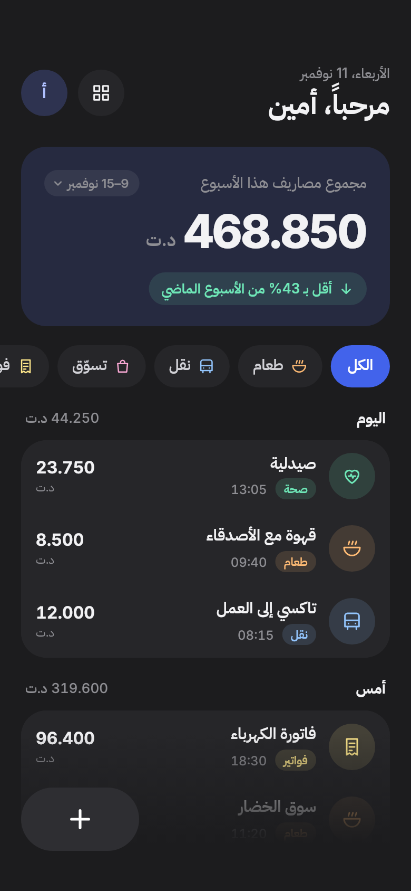 | | | |

Screenshots are rendered from the real screens with demo data (the design's sample month) by `test/screenshots/screenshots_test.dart`. Regenerate them after UI changes with:

```bash
SCREENSHOTS=1 flutter test test/screenshots
```

---

## Run it

```bash
cp env.example.json env.json   # then fill in the two Google client IDs
flutter pub get
flutter run --dart-define-from-file=env.json
```

Build an installable Android APK:

```bash
flutter build apk --release --dart-define-from-file=env.json
# → build/app/outputs/flutter-apk/app-release.apk
```

> The release build is currently signed with the debug key (Flutter's default), which is the SHA-1 registered in Google Cloud. Before publishing to Google Play, create an upload key, configure `signingConfigs` in `android/app/build.gradle.kts`, and add that key's SHA-1 to a second Android OAuth client.

The Supabase URL and publishable key are already baked into `lib/core/config/env.dart` (they're public by design; Row Level Security protects the data). Override them with `--dart-define=SUPABASE_URL=… --dart-define=SUPABASE_PUBLISHABLE_KEY=…` if you point at another project.

Without `GOOGLE_WEB_CLIENT_ID` the app runs, but the Login button shows "Google sign-in isn't configured for this build yet."

```bash
flutter test      # unit + widget tests
flutter analyze   # zero issues
```

---

## Backend: Supabase (already provisioned)

| | |
|---|---|
| Project | `cashflow-app` (`xjszjggrbjwugxjpfoqg`), region eu-west-3 (Paris) |
| URL | `https://xjszjggrbjwugxjpfoqg.supabase.co` |
| Schema | `supabase/migrations/*.sql` (already applied) |

### Data model

```
profiles   (id = auth.users.id, name, email, photo_url, currency, created_at)
categories (id, user_id, name?, default_key?, color_hex, icon_key, sort_order, is_default, created_at, updated_at)
expenses   (id, user_id, amount BIGINT, category_id, note?, date, created_at, updated_at)
```

- **Amounts are integers in thousandths** of the currency unit (millimes for TND), never floats. The scale is fixed, so changing the display currency only changes the symbol and decimals shown; it never rescales stored values.
- **Signing up** happens on the first Google sign-in. A trigger (`on_auth_user_created`) creates the profile and seeds the six default categories (Food, Transport, Shopping, Bills, Health, Other) with the design's colors and icons. Default categories store `default_key` and a `NULL` name, so the app shows their name in the current language. Once the user renames one, the custom name is used.
- **Row Level Security** is enabled on every table: each user can only read and write their own rows. Users can't insert "default" categories, can't change `default_key` / `is_default`, and can't delete "Other".
- **`delete_category(uuid)`** (RPC) moves the category's expenses to "Other", then deletes it, in one transaction. **`reorder_categories(uuid[])`** saves the order.
- Composite foreign key `(category_id, user_id) → categories(id, user_id)`, so an expense can never point at someone else's category.

To recreate the schema elsewhere: `supabase db push` (Supabase CLI), or run the files in `supabase/migrations/` in order in the SQL editor.

### Offline behavior
Reads are cached on the device (`SnapshotCache`): the app starts with the last data it saw even with no network. Writes are optimistic: the UI updates instantly, and rolls back with an error toast if the server rejects them. There is no offline write queue.

---

## Google sign-in setup (Google Cloud Console + Supabase)

Identifiers you'll need:

| | |
|---|---|
| Android package name | `com.cashflow.cashflow` |
| iOS bundle ID | `com.cashflow.cashflow` |
| Debug SHA-1 (this machine's `~/.android/debug.keystore`) | `F7:98:20:DE:99:D7:17:B8:E0:DC:35:DD:19:3B:D2:28:CF:B0:3C:2C` |
| Supabase callback URL | `https://xjszjggrbjwugxjpfoqg.supabase.co/auth/v1/callback` |

> Want a different package name / bundle ID (e.g. `tn.yourname.cashflow`)? Change it **before** creating the OAuth clients, because they're tied to it.

### 1. Google Cloud Console (https://console.cloud.google.com)

1. **Create a project** (e.g. "Cashflow") or pick an existing one.
2. **Google Auth Platform → Branding / OAuth consent screen**: app name *Cashflow*, support email, developer contact. Audience: *External*. While the app is in *Testing*, add your Google account(s) under **Test users**. Data access scopes: `openid`, `.../auth/userinfo.email`, `.../auth/userinfo.profile` (the defaults).
3. **Clients → Create client**, three times:
   - **Web application** (name: *Cashflow – Supabase*). Authorized redirect URI: the Supabase callback URL above. → gives a **Web client ID** and **client secret**.
   - **Android**: package `com.cashflow.cashflow`, SHA-1 above. Add a second Android client later with your **release** / Play App Signing SHA-1 (Play Console → App integrity). → no secret; it just authorizes the app.
   - **iOS**: bundle ID `com.cashflow.cashflow`. → gives an **iOS client ID** (and its reversed form, `com.googleusercontent.apps.…`).

Get a release SHA-1 any time with:

```bash
keytool -list -v -keystore <your-release.jks> -alias <alias>
```

### 2. Supabase dashboard → Authentication → Sign In / Providers → Google

- **Enable** Google.
- **Client IDs**: `<WEB_CLIENT_ID>,<IOS_CLIENT_ID>`, comma-separated, web first.
- **Client secret**: the Web client's secret.
- **Skip nonce checks**: **on** (required for native iOS sign-in).
- Save.

### 3. App config

- `env.json`: `GOOGLE_WEB_CLIENT_ID` ✅ set · `GOOGLE_IOS_CLIENT_ID` ⏳ pending (create the iOS client first).
- `ios/Flutter/GoogleSignIn.xcconfig`: `GOOGLE_WEB_CLIENT_ID` ✅ set · `GOOGLE_IOS_CLIENT_ID` and `GOOGLE_REVERSED_CLIENT_ID` ⏳ pending (used by `Info.plist` for the URL scheme).
- Keep the downloaded `*client_secret*.json` files out of the repo (they're git-ignored). The app only needs the client IDs.

On Android the app passes the **Web** client ID as `serverClientId`. Google then issues an ID token whose audience Supabase accepts. The Android client only needs to exist with the right package + SHA-1.

### Troubleshooting
- *"Google sign-in isn't configured"* → `GOOGLE_WEB_CLIENT_ID` missing from the build (`--dart-define-from-file=env.json`).
- Android `clientConfigurationError` / `[16] Account reauth failed` → SHA-1 or package name mismatch in the Android OAuth client.
- Supabase `Unacceptable audience in id_token` → the client ID isn't listed in Supabase's *Client IDs*.
- iOS `Passed nonce and nonce in id_token should either both exist or not` → turn on *Skip nonce checks*.
- Consent screen in *Testing* → only listed test users can sign in.

---

## Home-screen widget: "Today"

A small (2×2 / systemSmall) widget from the design: today's total, the "Today" label and the logo badge. The amount is dimmed when it's 0. It follows the app's language (RTL in Arabic) and theme. Tapping it opens the app straight on the **Add expense** sheet (`cashflow://add`).

How it works:
- The app computes today's total and pushes it, already formatted and localized, through [`home_widget`](https://pub.dev/packages/home_widget). It does this whenever expenses, currency, language or theme change, and again when the app returns to the foreground. See `lib/features/today_widget/`.
- The native widget only draws those values. When the stored date isn't today any more, it shows 0, so the number never carries over past midnight even if the app wasn't opened.

### Android: ready
`TodayWidgetProvider.kt` + `res/layout/today_widget*.xml`. The amount is drawn with the app's own Inter ExtraBold and shrinks to fit long totals. Long-press the home screen → Widgets → **Cashflow** → *Today*.

### iOS: code ready, needs one-time Xcode setup (Mac)
The Swift code is in `ios/TodayWidget/`. Xcode has to add the extension target:

1. Open `ios/Runner.xcworkspace` in Xcode.
2. **File → New → Target… → Widget Extension**. Product name `TodayWidget`, uncheck *Include Live Activity* and *Include Configuration App Intent*. When asked, *Activate* the scheme.
3. Delete the Swift files Xcode generated in the new `TodayWidget` group, and add `ios/TodayWidget/TodayWidget.swift` to the **TodayWidget** target instead.
4. Set the extension's deployment target to iOS 14+ (same team as Runner).
5. **Runner** target → *Signing & Capabilities* → **+ App Groups** → `group.com.cashflow.cashflow`. Do the same for the **TodayWidget** target. The entitlements files `Runner/Runner.entitlements` and `TodayWidget/TodayWidget.entitlements` already contain the group.
6. Build & run. Long-press the home screen → **+** → Cashflow.

The `cashflow://` URL scheme (for the widget tap) is already registered in `Runner/Info.plist`.

---

## Project structure (feature-first)

```
lib/
  core/
    config/      env (dart-defines)
    data/        snapshot cache (offline reads)
    icons/       design icon paths + tiny SVG path parser, Google logo, logo, empty-state art
    l10n/        ARB files (ar, fr, en) + generated AppLocalizations
    router/      go_router with auth redirect
    theme/       AppColors (dark/light), AppTextStyles, spacing/radii/motion tokens
    utils/       money formatting & keypad input, date labels, failures
    widgets/     AppButton, CircleIconButton, CategoryChip, CategoryPickerPill, CategoryBadge,
                 ExpenseTile + SwipeToDelete, TotalCard, AppBottomSheet, NumericKeypad,
                 SegmentedControl, EmptyState/ErrorState, undo toast
  features/
    auth/        AuthRepository (+ Supabase/Google impl), providers, Login
    categories/  CategoryRepository (+ Supabase impl), providers, list + editor sheet
    expenses/    ExpenseRepository (+ Supabase impl), monthly summary, Home, add/edit sheet
    settings/    SettingsRepository (prefs), ProfileRepository, Settings
    today_widget/ TodayWidgetData + home_widget bridge, sync, widget-tap handler
  app.dart, main.dart
android/.../TodayWidgetProvider.kt     native Android widget
ios/TodayWidget/                       WidgetKit extension (add target in Xcode)
assets/icon/                           app icon sources (SVG + PNG)
supabase/migrations/   SQL schema, RLS, trigger, RPCs
test/                  money, monthly totals, icons, repositories (fakes), today widget, widget flows
test/screenshots/      renders docs/screenshots (SCREENSHOTS=1)
```

The UI depends only on the repository **interfaces**. Swapping the backend means writing new `*Repository` implementations and changing the four providers that construct them.

## Design notes
- Tokens come straight from the design file's style guide: flat surfaces, **no gradients or glows** (the only gradient is the fade under Home's add button, as in the design). Motion: 120 ms press (scale .96), 200 ms toggles, 300 ms swipe/re-flow, 450 ms sheets, ease-out `cubic-bezier(.2,.8,.2,1)`. With Reduce motion on, the app uses fades or no animation.
- Fonts are bundled: Inter (Latin + all digits) with IBM Plex Sans Arabic as the fallback for Arabic script (SIL OFL; licenses in `assets/fonts`).
- Western digits (0–9) everywhere. `ar`/`en`: `1,284.500`, `fr`: `1 284,500`. The keypad, amounts, email addresses and the Google logo never mirror.
